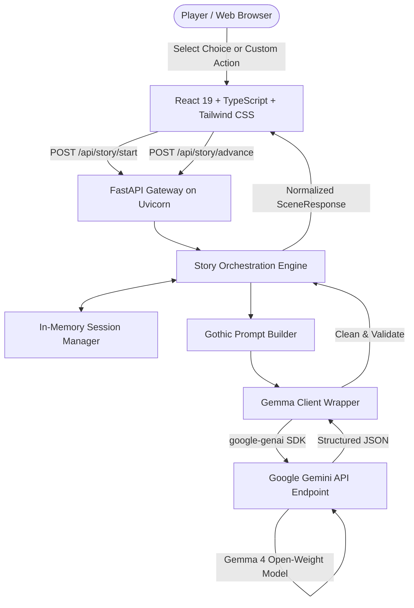

# Ghostwriter AI — Every Choice Leaves a Scar
> **An unscripted interactive horror-story generator where the machine remembers your decisions, powered by Google's open-weight Gemma model via the Gemini API.**  
> Built for the **DEV.to Hacktoberfest Week 4 2026** Challenge: *"Ghost in the Machine"*.

---

## 📖 The Problem and Creative Concept

Traditional text adventures and branching narrative games rely on pre-written decision trees. If you choose Door A, you get pre-baked Paragraph 12; if you choose Door B, you get pre-baked Paragraph 13. While predictable, this approach limits player agency and quickly loses tension once branches are discovered.

On the other hand, unstructured conversational AI chatbots lack memory discipline: they frequently suffer from tone drift, forget past decisions within a few turns, and lack pacing or stakes.

**Ghostwriter AI** bridges this gap:
It acts as an intelligent, literary storyteller that weaves genuine gothic horror. Every choice you select—or custom unscripted action you write—is committed to a persistent memory ledger. The dark intelligence lingering inside the machine remembers the clues you uncovered, the permanent psychological scars you sustained, and the paths you took, culminating in a fateful ending tailored to your actions.

---

## 👻 Why This Project Fits "Ghost in the Machine"

In classic folklore, a haunting is an echo of past trauma trapped inside an environment. In Ghostwriter AI, the *"Ghost"* is the persistent memory state tracking the player's cumulative sins and choices inside the AI's neural weights. The machine does not just generate words; it holds a grudge. As the story escalates, earlier reckless actions return as permanent scars, hallucinations, or environmental locks.

---

## ✨ Key Features

- **Near-Black Gothic Aesthetics**: Atmospheric charcoal-black backdrop, dynamic vignette, subtle film grain, and blood-red accents tailored for gothic horror.
- **Persistent Consequence Ledger**: The collapsible *"What the darkness remembers"* panel dynamically reflects your discovered clues, psychological trauma, active location, and previous decisions.
- **Unscripted Agency**: Select from 3 dynamically generated choices or carve your own path by submitting freeform custom actions that the AI seamlessly incorporates.
- **Open-Weight Gemma Engine**: Powered by Google's open-weight Gemma models (`gemma-4-26b-a4b-it` and `gemma-4-31b-it`) accessed through the official `google-genai` SDK and Gemini API delivery mechanism.
- **Atmospheric Pacing Engine**: Short (3–4 scenes), Medium (5–7 scenes), or Long (8–10 scenes) story budgets prevent rambling and guide the narrative toward a definitive climax.
- **Autopsy Endings**: Reaches one of five emergent fates (*Escape*, *Survival with a cost*, *Tragic ending*, *Supernatural revelation*, or *Hidden ending*) with a choice autopsy and unresolved mystery report.
- **Accessible & Responsive**: Fully responsive across mobile and desktop, with keyboard navigation (`[1]`, `[2]`, `[3]` hotkeys) and full `prefers-reduced-motion` compliance.

---

## 🏛️ System Architecture



---

## 🔬 Why Gemma and Open-Weight AI?

1. **Open-Weight Transparency**: Google's Gemma models provide open-weight availability with published technical reports and architecture details. Open weights ensure developers and researchers can audit behavior, understand alignment, and inspect tokenization.
2. **High Literary Capability**: The Gemma 4 series demonstrates exceptional command of atmospheric tone, sensory imagery, and adherence to complex JSON schemas.
3. **Accessible Hosted Delivery**: Through the Gemini API endpoint, players experience real-time generative storytelling without needing 48GB+ of local VRAM.

> **Hosted Inference & Privacy Disclosure**:  
> Story generation is performed via remote API calls to Google's Gemini API endpoint using the configured Gemma open-weight model. No personal identifiers or authentication credentials are required or stored. Story sessions are held in browser `sessionStorage` and ephemeral server memory.

---

## 📂 Project Structure

```
GhostWriter AI/
├── frontend/                     # Frontend Application
│   ├── src/
│   │   ├── components/           # UI components (AtmosphericBackground, StoryChoices, etc.)
│   │   ├── pages/                # LandingPage, StorySetupPage, StoryPlayerPage, EndingPage
│   │   ├── hooks/                # useStorySession, useApiHealth
│   │   ├── services/api.ts       # Centralized Fetch API client
│   │   ├── types/story.ts        # TypeScript schemas
│   │   └── App.tsx               # State machine router
│   ├── .env.example              # Frontend environment placeholders
│   ├── package.json
│   └── vite.config.ts
│
├── backend/                      # Backend Application
│   ├── app/
│   │   ├── api/routes.py         # REST endpoints (/api/health, /api/story/start, /api/story/advance)
│   │   ├── config.py             # Pydantic BaseSettings loading environment variables
│   │   ├── main.py               # FastAPI application with CORS & error handlers
│   │   ├── prompts/storyteller.py# System instructions & dynamic prompt generators
│   │   ├── schemas/story.py      # Pydantic request and response schemas
│   │   ├── services/
│   │   │   ├── gemma_client.py   # google-genai SDK client with bounded retry
│   │   │   ├── story_engine.py   # Story lifecycle, budget & choice validation
│   │   │   └── story_memory.py   # In-memory session manager
│   │   └── utils/errors.py       # Domain exceptions (404, 400, 502, 503)
│   ├── tests/                    # Automated Pytest suite
│   ├── requirements.txt          # Python dependencies
│   └── .env.example              # Backend environment placeholders
│
├── docs/
│   └── devto-submission.md       # DEV.to Hacktoberfest submission draft
├── LICENSE                       # MIT License
└── README.md                     # Project documentation
```

---

## ⚙️ Prerequisites

- **Python 3.11 or later** (Tested on Python 3.14)
- **Node.js 18+ and npm 9+** (Tested on Node 24 & npm 11)
- **Google AI Studio API Key** (Free tier available at [Google AI Studio](https://aistudio.google.com/))

---

## 🚀 Installation & Local Setup

### 1. Backend Setup

```bash
# Navigate to backend directory
cd backend

# Create and activate virtual environment
python -m venv .venv

# Windows (PowerShell)
.\.venv\Scripts\Activate.ps1
# Linux / macOS
source .venv/bin/activate

# Install dependencies
pip install -r requirements.txt

# Configure environment
cp .env.example .env
```

Open `backend/.env` and insert your Google AI Studio API key:
```ini
GEMINI_API_KEY=AIzaSyYourActualKeyHere
GEMMA_MODEL_ID=gemma-4-26b-a4b-it
FRONTEND_ORIGIN=http://localhost:5173
ENVIRONMENT=development
```

Start the backend server:
```bash
uvicorn app.main:app --host 127.0.0.1 --port 8000 --reload
```
The backend API is now running at `http://127.0.0.1:8000`. You can inspect the interactive Swagger docs at `http://127.0.0.1:8000/docs`.

### 2. Frontend Setup

In a separate terminal:
```bash
# Navigate to frontend directory
cd frontend

# Install dependencies
npm install

# Configure environment
cp .env.example .env
```

Ensure `frontend/.env` points to your backend:
```ini
VITE_API_BASE_URL=http://localhost:8000
```

Start the Vite development server:
```bash
npm run dev
```

Open `http://localhost:5173/` in your browser.

---

## 🧪 Running Automated Tests

Run the backend unit test suite:
```bash
# From the repository root
backend\.venv\Scripts\pytest backend\tests -v
```

All 13 unit tests run with mocked models in under 2 seconds, verifying:
- Health check endpoints in configured and unconfigured modes.
- Strict Pydantic input validation for settings, intensities, and action requirements.
- Opening scene generation and session initialization.
- Dynamic choice advancement and custom player actions.
- Bounded single-retry recovery from malformed JSON model output.
- CORS preflight and headers.

To verify frontend TypeScript compilation and production bundle build:
```bash
cd frontend
npm run build
```

---

## 🩺 Troubleshooting

### 1. `Backend Offline / Degraded` Status in UI
- Check that the backend server is running on `http://127.0.0.1:8000`.
- Verify that `GEMINI_API_KEY` is populated in `backend/.env`. If the key is missing or blank, `/api/health` reports `status: "degraded"` and story requests return HTTP 503 with configuration instructions.

### 2. `Model not found (404)` Error
- Ensure `GEMMA_MODEL_ID` in `backend/.env` is set to an active Gemma model. We recommend `gemma-4-26b-a4b-it` or `gemma-4-31b-it`.

### 3. CORS Connection Errors
- If accessing the frontend via `http://localhost:5173`, the backend CORS middleware automatically allows both `http://localhost:5173` and `http://127.0.0.1:5173`. Ensure `FRONTEND_ORIGIN` matches the exact URL and port of your browser tab.

### 4. Generation Timeout
- Generative inference on larger models can take 5–15 seconds depending on network load. The frontend Fetch client has a 60-second timeout. If a timeout occurs, click the **"Retry"** button on the error banner to resend your last action without losing history.

---

## ⚠️ Current Limitations

- **In-Memory Session Storage**: Active story sessions are stored in memory on the server and in browser `sessionStorage`. Restarting the backend server clears active server-side sessions.
- **Hosted Inference Requirement**: The application requires an active internet connection to communicate with Google's Gemini API endpoints.

---

## 📄 License & Attribution

- **Source Code**: Released under the [MIT License](LICENSE).
- **AI Model**: Google Gemma open-weight models are subject to the [Gemma Terms of Use](https://ai.google.dev/gemma/terms).
- Built with pride for **DEV.to Hacktoberfest 2026**.
