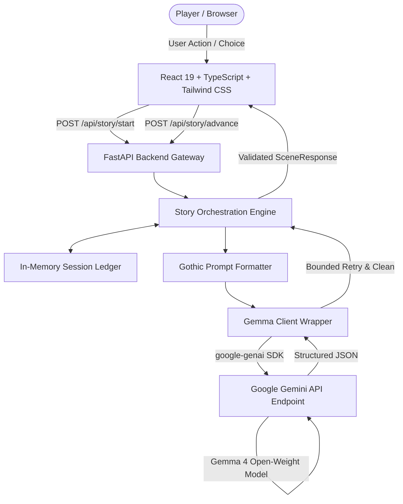

# Ghostwriter AI — Every Choice Leaves a Scar

> **Submission for the DEV.to Hacktoberfest Week 4 2026 Challenge: *"Ghost in the Machine"***

---

## 🌒 The Concept: The Machine That Remembers

Most text adventures and gamebooks follow strict pre-scripted decision trees: choose option A or option B, leading to room 104 or room 105. Conversely, modern conversational AI chatbots often suffer from conversational amnesia, hallucinatory shifts in tone, or generic "helpful assistant" personas that ruin suspense.

**Ghostwriter AI** was conceived to invert this paradigm for the *"Ghost in the Machine"* theme:

What if the intelligence lurking inside the machine doesn't just respond to you, but **actively tracks your scars, your psychological trauma, and your unprompted actions** across every chamber? What if every single choice leaves an indelible mark on the ledger of the dark?

In Ghostwriter AI:
- There are no static railroads. Narrative passages, choices, and atmospheric clues are generated dynamically using Google's **Gemma open-weight model** via the **Google Gen AI Python SDK** (`google-genai`) and the Gemini API.
- The player can select from 3 dynamic choices or **carve their own fate** with freeform custom actions (e.g., *"Press your fingertips against the peeling wallpaper near the hearth to feel for drafts"*).
- The engine maintains a persistent *"What the darkness remembers"* ledger tracking uncovered clues, psychological wounds, locations, and past decisions.
- Every story terminates in a comprehensive autopsy ending: *Escape*, *Survival with a cost*, *Tragic ending*, *Supernatural revelation*, or a *Hidden ending*.

---

## 🎥 Demos & Links

- **GitHub Repository**: <!-- TODO: Insert your public repository URL (e.g., https://github.com/YourUsername/ghostwriter-ai) -->
- **Working Live Demo**: <!-- TODO: Insert your hosted demo URL if deployed (e.g., https://ghostwriter-ai.vercel.app) -->
- **Walkthrough Video**: <!-- TODO: Insert your Loom/YouTube demo video link -->

---

## 🧠 Why Open-Weight AI (Gemma) via the Gemini API?

For this challenge, we wanted an intelligence that could balance literary gothic prose with strict JSON schema fidelity without needing black-box closed models.

### 1. Open Weights, Transparent Lineage
Google's **Gemma** is an open-weight family of models built from the same research and technology used to create Gemini. Utilizing open-weight models ensures that developers, researchers, and game designers have full inspectability into model weights, safety alignments, and tokenizers.

### 2. High Literary Quality with Hosted Inference
By accessing Gemma models (such as `gemma-4-26b-a4b-it` and `gemma-4-31b-it`) via the Gemini API delivery mechanism, the application achieves high-throughput, low-latency generative inference without requiring users to own a multi-thousand-dollar GPU cluster locally.

> **Hosted Inference Disclosure**: Narrative prompts and player actions are processed remotely via the Google Gemini API endpoint using the configured Gemma open-weight model. The frontend contains no private keys; all requests pass through the FastAPI backend gateway.

---

## 🏛️ System Architecture

Ghostwriter AI separates presentation, state management, and inference into a clean, decoupled full-stack architecture:



---

## 🛠️ Technology Stack

### Frontend
- **React 19 & TypeScript**: Strict type safety ensuring zero mismatch with backend schemas.
- **Vite 6**: Fast modular development server and optimized production bundling.
- **Tailwind CSS v3**: Tailored dark gothic design system featuring near-black backgrounds (`#0a0a0c`), off-white typography, and blood-red accents.
- **Lucide React**: Clean iconography for atmospheric indicators and memory badges.
- **Native Fetch API**: Built-in resilient service client with configurable timeouts and failure recovery.

### Backend
- **Python 3.14 / 3.11+ & FastAPI**: High-performance asynchronous API framework.
- **Pydantic v2 & Pydantic Settings**: Strict contract validation and zero-leak environment configuration.
- **Google Gen AI Python SDK (`google-genai`)**: Official SDK for communicating with Gemini API endpoints.
- **Uvicorn**: Lightweight ASGI server.
- **Pytest & Pytest-Asyncio**: 13 automated unit and integration tests covering the full story lifecycle.

---

## 🔮 Engineering Highlights & Lessons Learned

### 1. Robust Structured JSON Parsing with Bounded Retry
Large language models can occasionally wrap JSON in explanatory text or markdown code fences (````json ... ````). Rather than failing abruptly, our `gemma_client.py` implements:
- Code-fence extraction using regex patterns.
- Boundary detection finding the first `{` and last `}`.
- A **bounded single retry** that re-prompts Gemma with strict schema reinforcement if JSON decoding fails.

### 2. Pacing Budgets and Emergent Endings
A common pitfall with AI storytelling is stories that wander endlessly. Ghostwriter AI incorporates a **scene budget**:
- **Short** (3–4 scenes): Fast encounter.
- **Medium** (5–7 scenes): Deepening mystery.
- **Long** (8–10 scenes): Comprehensive descent.

When the story approaches its budget, the system instruction shifts Gemma from escalating tension to delivering a decisive, climactic ending based on the cumulative decisions and scars recorded in the memory ledger.

### 3. Accessible Gothic Aesthetics
Dark-themed interfaces often suffer from poor contrast or excessive neon glows. We took inspiration from classic horror publications:
- **Cinzel** for titles and headers.
- **EB Garamond** for narrative passages with distinct dialogue styling.
- **Inter** for clean UI controls.
- Keyboard shortcuts (`[1]`, `[2]`, `[3]`) for rapid, accessible decision-making.
- Complete adherence to `prefers-reduced-motion`.

---

## 🧪 Automated Testing

All core backend logic is covered by automated unit tests that run in milliseconds without consuming paid quota:

```bash
pytest backend/tests -v
```

Test breakdown:
- `test_health.py`: Verifies status reporting for configured & unconfigured instances.
- `test_story.py`: Verifies mock story progression, choice tracking, custom player actions, ending transitions, and bounded retry logic.
- `test_validation.py`: Ensures malformed settings, invalid lengths, and missing choices are rejected with HTTP 422.

---

## 🚀 Running Locally

### 1. Clone the Repository
```bash
git clone https://github.com/YourUsername/ghostwriter-ai.git
cd ghostwriter-ai
```

### 2. Backend Setup
```bash
cd backend
python -m venv .venv
.\.venv\Scripts\activate   # Windows
# or: source .venv/bin/activate # macOS/Linux

pip install -r requirements.txt
cp .env.example .env
# Add your GEMINI_API_KEY in .env

uvicorn app.main:app --host 127.0.0.1 --port 8000 --reload
```

### 3. Frontend Setup
```bash
cd ../frontend
npm install
cp .env.example .env
npm run dev
```

Visit `http://localhost:5173/` and enter the unknown!

---

## 👥 Credits & Acknowledgments
- Built with ❤️ for **DEV.to Hacktoberfest 2026** — *"Ghost in the Machine"*.
- Powered by Google's open-weight **Gemma model** via the **Gemini API**.
- Open-sourced under the [MIT License](https://opensource.org/licenses/MIT).
